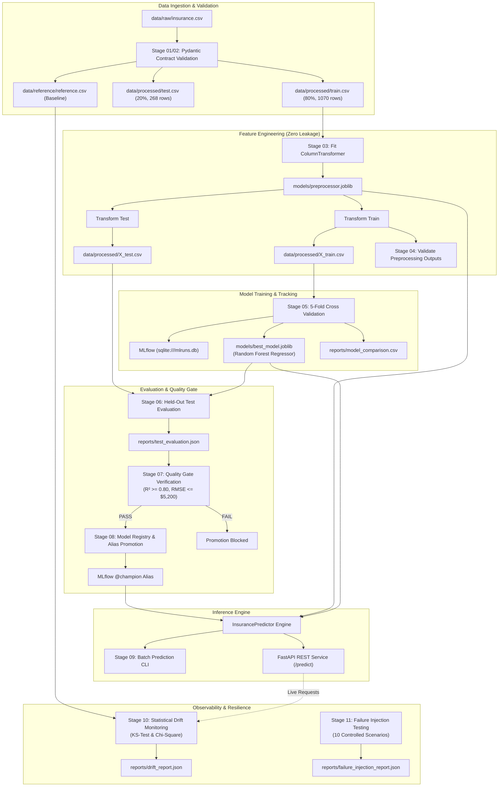

# Insurance Charges Prediction — End-to-End MLOps System


A production-grade, modular, and beginner-friendly End-to-End Machine Learning Operations (MLOps) project built on macOS using Python 3.11. The system accurately estimates individual healthcare charges billed by health insurance, adhering to strict industry standards: zero data leakage, Pydantic data validation, automated quality gates, model registry lifecycle management, real-time FastAPI serving, statistical drift monitoring, resilience testing, containerization, and Kubernetes manifests.

---

## Table of Contents
1. [Project Overview & Problem Statement](#1-project-overview--problem-statement)
2. [Dataset & Feature Specification](#2-dataset--feature-specification)
3. [System Architecture](#3-system-architecture)
4. [Project Directory Layout](#4-project-directory-layout)
5. [Technology Stack](#5-technology-stack)
6. [macOS Environment Setup & Quickstart](#6-macos-environment-setup--quickstart)
7. [Pipeline Execution Guide](#7-pipeline-execution-guide)
8. [Model Evaluation & Verified Metrics](#8-model-evaluation--verified-metrics)
9. [MLflow Experiment Tracking & Model Registry](#9-mlflow-experiment-tracking--model-registry)
10. [Quality Gates & Production Criteria](#10-quality-gates--production-criteria)
11. [Production Inference Services](#11-production-inference-services)
    - [Batch Prediction CLI](#batch-prediction-cli)
    - [FastAPI Microservice](#fastapi-microservice)
12. [Statistical Data Drift Monitoring](#12-statistical-data-drift-monitoring)
13. [Failure Injection & Resilience Testing](#13-failure-injection--resilience-testing)
14. [Docker Containerization](#14-docker-containerization)
15. [Kubernetes Deployment](#15-kubernetes-deployment)
16. [GitHub Actions CI/CD](#16-github-actions-cicd)
17. [Troubleshooting](#17-troubleshooting)
18. [Limitations & Roadmap](#18-limitations--roadmap)

---

## 1. Project Overview & Problem Statement

Accurately predicting medical insurance expenses is critical for insurance providers, healthcare networks, and policyholders. Individual medical charges are influenced by non-linear combinations of age, lifestyle choices (such as smoking status), and physiological metrics (Body Mass Index).

This project implements a complete **MLOps architecture** to:
1. Ingest raw medical data and validate integrity via strict Pydantic schemas.
2. Train, compare, and version candidate regression models under 5-Fold Cross Validation.
3. Prevent data leakage by fitting feature preprocessing strictly on training splits.
4. Gate model promotions with automated quality thresholds.
5. Provide real-time and batch prediction services.
6. Continually monitor production data for statistical distribution drift.
7. Verify operational resilience against 10 safe failure scenarios.

---

## 2. Dataset & Feature Specification

The dataset consists of **1,338 historical patient records** (`data/raw/insurance.csv`):

| Feature Name | Data Type | Permissible Range / Values | Description |
| :--- | :--- | :--- | :--- |
| `age` | Integer | 18 – 64 (validated up to 100) | Age of primary beneficiary |
| `sex` | Categorical | `female`, `male` | Insurance contractor gender |
| `bmi` | Float | 15.96 – 53.13 (validated 10 – 70) | Body Mass Index ($kg/m^2$) |
| `children` | Integer | 0 – 5 (validated up to 20) | Number of dependents covered |
| `smoker` | Categorical | `yes`, `no` | Smoking status |
| `region` | Categorical | `northeast`, `northwest`, `southeast`, `southwest` | Residential area in the US |
| **`charges`** | Float | **$1,121.87 – $63,770.43 (USD)** | **Target Variable: Medical costs billed** |

### Data Quality Verification
- **Missing Values**: 0 (0.0%).
- **Duplicate Records**: 1 duplicate row detected at index 581 (reported and configurably handled).
- **Target Distribution**: Right-skewed continuous variable requiring robust non-linear models.

---

## 3. System Architecture



---

## 4. Project Directory Layout

```text
Insurance prediction/
├── .github/
│   └── workflows/
│       ├── ci.yml                 # GitHub Actions CI (lint, tests, coverage, pipeline)
│       └── cd.yml                 # GitHub Actions CD (wheel packaging, Docker health probe)
├── config/
│   ├── config.yaml                # Master pipeline configuration
│   └── quality_gates.yaml         # Performance gates & thresholds
├── data/
│   ├── raw/
│   │   └── insurance.csv          # Raw source dataset (1,338 records)
│   ├── processed/                 # Generated partitions (train, test, X, y)
│   └── reference/
│       └── reference.csv          # Baseline dataset for drift detection
├── docs/
│   ├── architecture.md            # In-depth architectural design
│   ├── project_execution.md       # Pipeline execution instructions
│   ├── project_summary.md         # Final verified metrics summary
│   └── troubleshooting.md        # Diagnostics & solutions
├── k8s/
│   ├── configmap.yaml             # Kubernetes ConfigMap for non-sensitive env
│   ├── deployment.yaml            # Scalable Deployment (2 replicas, health probes)
│   ├── service.yaml               # ClusterIP internal service
│   └── README.md                  # Kubernetes deployment guide
├── models/
│   ├── best_model.joblib          # Winning serialized model artifact
│   └── preprocessor.joblib        # Fitted ColumnTransformer artifact
├── reports/                       # Generated evaluation & drift reports
├── src/
│   ├── insurance_mlops/           # Core reusable library
│   │   ├── data/                  # Ingestion, validation & Pydantic schema
│   │   ├── features/              # ColumnTransformer & feature engineering
│   │   ├── models/                # Training, 5-fold CV & MLflow registry
│   │   ├── evaluation/            # Metrics & quality gate enforcement
│   │   ├── inference/             # Predictor engine & FastAPI service
│   │   ├── monitoring/            # KS-test drift detector & failure injection
│   │   └── utils/                 # Logging and YAML config loader
│   └── mlops_pipeline/            # Executable standalone pipeline stages (03-12)
├── tests/                         # Pytest test suite (71 passing tests)
├── Dockerfile                     # Non-root container definition
├── docker-compose.yml             # Local container service orchestration
├── pyproject.toml                 # Packaging build metadata
├── requirements.txt               # Pinned dependencies
└── README.md                      # Comprehensive project documentation
```

---

## 5. Technology Stack

- **Language & Runtime**: Python 3.11.7 on macOS
- **Data & Computation**: `pandas`, `numpy`, `scipy`
- **Machine Learning**: `scikit-learn`, `joblib`
- **Experiment Tracking & Registry**: `mlflow` (SQLite backend with Model Aliases)
- **Data Validation & Schemas**: `pydantic`
- **Web API & Serving**: `fastapi`, `uvicorn`, `httpx`
- **Statistical Testing**: Two-Sample Kolmogorov-Smirnov (`scipy.stats.ks_2samp`), Chi-Square (`scipy.stats.chi2_contingency`)
- **Automated Testing & QA**: `pytest`, `pytest-cov`, `flake8`
- **Containerization**: `docker`, `docker-compose`
- **Orchestration**: `kubernetes` (Minikube / Docker Desktop ready)
- **CI/CD**: `GitHub Actions`

---

## 6. macOS Environment Setup & Quickstart

```bash
# 1. Clone repository and navigate to root
cd "/Users/pavan/Downloads/Insurance prediction"

# 2. Create and activate Python 3.11 virtual environment
python3.11 -m venv venv
source venv/bin/activate

# 3. Upgrade build tools and install pinned dependencies
pip install --upgrade pip setuptools wheel
pip install -r requirements.txt

# 4. Install insurance-mlops package in editable mode
pip install --no-build-isolation -e .
```

---

## 7. Pipeline Execution Guide

### Master One-Click Execution (All Stages in ~10 Seconds)
```bash
python src/mlops_pipeline/12_end_to_end_pipeline.py
```
This executes stages 01 through 11 sequentially, records execution times, and outputs a formatted summary table.

### Individual Stage Execution Commands

```bash
# Stage 01/02: Ingestion & Pydantic Validation
python -c 'from insurance_mlops.data.loader import run_data_pipeline; run_data_pipeline()'

# Stage 03: Feature Preprocessing (fit on train only)
python src/mlops_pipeline/03_preprocessing.py

# Stage 04: Validate Preprocessing Outputs (zero leakage, zero NaNs)
python src/mlops_pipeline/04_validate_outputs.py

# Stage 05: Train Models, 5-Fold CV & MLflow Tracking
python src/mlops_pipeline/05_train_registry.py

# Stage 06: Held-Out Test Evaluation (unseen 268 rows)
python src/mlops_pipeline/06_model_evaluation.py

# Stage 07: Quality Gate Enforcement
python src/mlops_pipeline/07_quality_gate.py

# Stage 08: Model Registry & Alias Promotion (@champion)
python src/mlops_pipeline/08_automate_lifecycle.py

# Stage 09: Batch Production Prediction
python src/mlops_pipeline/09_inference.py \
  --input-path data/processed/sample_inference_input.csv \
  --output-path data/processed/batch_predictions.csv

# Stage 10: Statistical Data Drift Monitoring
python src/mlops_pipeline/10_drift_monitoring.py \
  --input-path data/processed/test.csv

# Stage 11: Resilience & Failure Injection (10 scenarios)
python src/mlops_pipeline/11_failure_injection.py
```

---

## 8. Model Evaluation & Verified Metrics

### 5-Fold Cross Validation Results (1,070 Training Rows)

| Model Candidate | CV RMSE ($) | CV RMSE Std ($) | CV MAE ($) | CV $R^2$ | Decision |
| :--- | :--- | :--- | :--- | :--- | :--- |
| **Random Forest Regressor** | **$4,620.94** | **$583.60** | **$2,571.20** | **0.8508** | **★ WINNER (Champion)** |
| **Gradient Boosting Regressor** | $4,622.85 | $556.35 | $2,599.21 | 0.8509 | Runner-up |
| **Linear Regression** | $6,123.35 | $491.65 | $4,234.98 | 0.7388 | Baseline |

### Held-Out Test Evaluation Results (Unseen $N=268$)

- **Root Mean Squared Error (RMSE)**: **$4,462.02**
- **Mean Absolute Error (MAE)**: **$2,529.67**
- **Coefficient of Determination ($R^2$)**: **0.8718**
- **Overfitting Delta ($\Delta R^2 = |R^2_{train} - R^2_{test}|$ )**: **0.0309** (Strictly within $\le 0.15$ threshold)

---

## 9. MLflow Experiment Tracking & Model Registry

Launch the local MLflow dashboard:
```bash
mlflow ui --backend-store-uri sqlite:///mlruns.db --port 5000
```
Open [http://localhost:5000](http://localhost:5000) to inspect:
- **Experiment Runs**: Cross-validation parameters, RMSE/MAE/R² metrics, and fitted scikit-learn artifacts.
- **Model Registry**: Registered model `insurance_charges_regressor`.
- **Modern Model Alias**: Promoted version tagged with alias **`@champion`** (replacing deprecated stages).

---

## 10. Quality Gates & Production Criteria

Configured in `config/quality_gates.yaml`:

| Gate Metric | Threshold | Actual Verified | Status |
| :--- | :--- | :--- | :--- |
| **Held-Out $R^2$** | $\ge 0.8000$ | **$0.8718$** | **✓ PASS** |
| **Held-Out RMSE** | $\le \$5,200.00$ | **$\$4,462.02$** | **✓ PASS** |
| **Held-Out MAE** | $\le \$3,000.00$ | **$\$2,529.67$** | **✓ PASS** |
| **Overfitting Delta ($\Delta R^2$)** | $\le 0.1500$ | **$0.0309$** | **✓ PASS** |

**Enforcement Guarantee**: If any condition fails, the model is strictly rejected and promotion to `@champion` is blocked.

---

## 11. Production Inference Services

### Batch Prediction CLI
```bash
python src/mlops_pipeline/09_inference.py \
  --input-path data/processed/sample_inference_input.csv \
  --output-path data/processed/batch_predictions.csv
```

### FastAPI Microservice
Start the server:
```bash
uvicorn insurance_mlops.inference.api:app --host 0.0.0.0 --port 8000 --reload
```
Interactive Swagger documentation is available at [http://localhost:8000/docs](http://localhost:8000/docs).

#### Health Probe (`GET /health`)
```bash
curl -X GET http://localhost:8000/health
```
```json
{
  "status": "healthy",
  "model_name": "random_forest",
  "model_version": "champion",
  "artifacts_loaded": true
}
```

#### Real-Time Prediction (`POST /predict`)
```bash
curl -X POST http://localhost:8000/predict \
  -H "Content-Type: application/json" \
  -d '{
    "age": 35,
    "sex": "male",
    "bmi": 26.5,
    "children": 1,
    "smoker": "no",
    "region": "northwest"
  }'
```
```json
{
  "predicted_charges": 4821.52,
  "model_name": "random_forest",
  "model_version": "champion"
}
```

---

## 12. Statistical Data Drift Monitoring

The monitoring service compares incoming data distributions against `data/reference/reference.csv`:

| Feature | Feature Type | Statistical Test | Statistic | $p$-value | Status |
| :--- | :--- | :--- | :--- | :--- | :--- |
| `age` | Numerical | Two-Sample Kolmogorov-Smirnov | 0.0488 | 0.6670 | `NO_DRIFT` |
| `bmi` | Numerical | Two-Sample Kolmogorov-Smirnov | 0.0562 | 0.4888 | `NO_DRIFT` |
| `children` | Numerical | Two-Sample Kolmogorov-Smirnov | 0.0189 | 1.0000 | `NO_DRIFT` |
| `sex` | Categorical | Chi-Square Contingency | 0.8892 | 0.3457 | `NO_DRIFT` |
| `smoker` | Categorical | Chi-Square Contingency | 0.0042 | 0.9485 | `NO_DRIFT` |
| `region` | Categorical | Chi-Square Contingency | 2.9395 | 0.4010 | `NO_DRIFT` |

- **Alert Threshold**: $\text{Drift Share} \ge 33\%$.
- **Current Status**: **`HEALTHY`** (0 / 6 features drifted, Alert triggered: `False`).

---

## 13. Failure Injection & Resilience Testing

The system evaluates 10 safe failure scenarios without damaging real project artifacts:
```bash
python src/mlops_pipeline/11_failure_injection.py
```

| ID | Scenario | Expected Behavior | Verification |
| :---: | :--- | :--- | :--- |
| 1 | Missing Raw Dataset | Caught `FileNotFoundError` | **✓ PASS** |
| 2 | Invalid Data Schema | Caught `ValueError` (Pydantic) | **✓ PASS** |
| 3 | Missing Model Artifact | Caught `FileNotFoundError` | **✓ PASS** |
| 4 | Missing Preprocessor Artifact | Caught `FileNotFoundError` | **✓ PASS** |
| 5 | Invalid Inference Payload | Caught `ValueError` | **✓ PASS** |
| 6 | Substandard Model Metrics | Quality Gate reports `FAIL` | **✓ PASS** |
| 7 | Distribution Drift Shift | Triggers `DRIFT_ALERT` | **✓ PASS** |
| 8 | Missing Service Artifacts | API returns HTTP 503 | **✓ PASS** |
| 9 | Failed Gate Promotion | MLflow Promotion Blocked | **✓ PASS** |
| 10 | Corrupt Config YAML | Caught `FileNotFoundError` | **✓ PASS** |

**Resilience Rate**: **10 / 10 Scenarios Handled (100%)**.

---

## 14. Docker Containerization

The project includes a multi-stage, non-root Dockerfile for security compliance:

```bash
# Build production Docker image
docker build -t insurance-mlops-api:latest .

# Run container locally
docker run -d --name insurance_api -p 8000:8000 insurance-mlops-api:latest

# Verify health inside container
curl http://localhost:8000/health

# Stop and remove container
docker stop insurance_api && docker rm insurance_api
```

### Docker Compose
```bash
docker compose up -d
docker compose ps
docker compose down
```

---

## 15. Kubernetes Deployment

Production-ready Kubernetes manifests are located in `k8s/`:

```bash
# 1. Apply ConfigMap
kubectl apply -f k8s/configmap.yaml

# 2. Apply Deployment (2 replicas with health & readiness probes)
kubectl apply -f k8s/deployment.yaml

# 3. Apply ClusterIP Service
kubectl apply -f k8s/service.yaml

# 4. Forward port to test locally
kubectl port-forward service/insurance-api-service 8080:80

# 5. Test health via Kubernetes service
curl http://localhost:8080/health
```

---

## 16. GitHub Actions CI/CD

Enterprise workflows are configured in `.github/workflows/`:

- **`ci.yml`**:
  - Triggers on push and pull requests to `main`.
  - Sets up Python 3.11 with pip caching.
  - Runs `flake8` linting and all 71 pytest unit & integration tests.
  - Uploads `reports/test-results.xml` and `reports/coverage.xml` artifacts.
- **`cd.yml`**:
  - Triggers only when CI succeeds on `main`.
  - Builds standalone Python Wheel distribution (`dist/*.whl`).
  - Builds Docker container image and performs live `/health` and `/predict` probes inside runner.
  - Decoupled from cloud publishing to eliminate unauthorized cloud spending.

---

## 17. Troubleshooting

Detailed diagnostics are documented in [`docs/troubleshooting.md`](docs/troubleshooting.md).

- **Artifact Not Found**: Run `python src/mlops_pipeline/12_end_to_end_pipeline.py`.
- **Quality Gate Failed**: Check `reports/test_evaluation.json` and adjust hyperparameters or review `config/quality_gates.yaml`.
- **Port 8000 Occupied**: Identify conflicting PID with `lsof -i :8000` or specify alternative port `--port 8080`.
- **Database Locked**: Ensure no lingering MLflow processes hold locks on `mlruns.db`.

---

## 18. Limitations & Roadmap

### Current Limitations
- **Dataset Size**: 1,338 rows represents a clean baseline; high-dimensional healthcare claims benefit from larger data pools.
- **Single-Node MLflow**: Local SQLite tracking backend is designed for local developer workflows.

### Future Improvements
1. **Advanced Gradient Boosters**: Integrate XGBoost, LightGBM, and CatBoost with Bayesian hyperparameter optimization (Optuna).
2. **Streaming Ingestion**: Real-time Kafka / AWS Kinesis feature streaming.
3. **Observability**: Prometheus metrics exporter and Grafana dashboard for API latency and drift metrics.
4. **Cloud Model Registry**: Migrate MLflow backend to AWS RDS (PostgreSQL) and S3 / GCS artifact stores.

---

## 19. Verification & Automated Testing

Run the full project test suite locally:

```bash
# Run all 71 unit and integration tests
pytest tests/ -v

# Run with coverage report (>85% coverage)
pytest tests/ -v --cov=src/insurance_mlops --cov-report=term-missing

# Run PEP 8 linting
flake8 src tests
```
