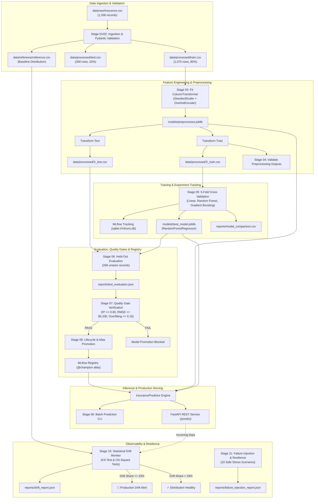

# System Architecture — Insurance Cost Prediction MLOps

## 1. High-Level Architectural Overview

The **Insurance Cost Prediction MLOps System** is designed around modular, production-grade principles to estimate individual healthcare charges based on demographic and lifestyle indicators. The system emphasizes:
- **Zero Data Leakage Boundary**: Preprocessing transformers are fit strictly on training partitions and serialized.
- **Contract-Driven Validation**: Schema and domain constraints are enforced using Pydantic.
- **Automated Quality Gates**: Objective performance criteria prevent substandard models from reaching production.
- **Enterprise Lifecycle Management**: Model versioning and alias promotion (`@champion`) via MLflow Model Registry.
- **Production Serving**: Dual inference paths via Batch CLI and a FastAPI REST service.
- **Continuous Monitoring**: Two-sample Kolmogorov-Smirnov and Chi-Square statistical drift tests.
- **Cloud-Native Deployment**: Non-root Docker containerization and Kubernetes manifests.

---

## 2. End-to-End Pipeline Architecture (Mermaid)

---

## 3. Core Subsystems

### A. Data Ingestion & Validation
- **Pydantic Data Contracts**: Validates demographic ranges (`age: 18-100`, `bmi: 10.0-70.0`, `children: 0-20`) and categorical enumerations (`sex`, `smoker`, `region`).
- **Configurable Deduplication**: Reports duplicate records (e.g. index 581) and preserves or drops them based on configuration (`drop_duplicates: false`).

### B. Feature Preprocessing Pipeline
- **Numerical Pipeline**: Continuous variables (`age`, `bmi`, `children`) transformed via `StandardScaler`.
- **Categorical Pipeline**: Nominal features (`sex`, `smoker`, `region`) encoded via `OneHotEncoder(handle_unknown='ignore')`.
- **Integrity Validation**: Verifies zero NaNs, infinite values, and row-count alignment between features and targets.

### C. Model Training & Comparison
- Evaluates 3 distinct model architectures using 5-Fold Cross Validation:
  1. `linear_regression` (Baseline)
  2. `random_forest` (Selected Best Model)
  3. `gradient_boosting` (Competitive Ensemble)
- Winning model artifact serialized to `models/best_model.joblib`.

### D. Quality Gates & Lifecycle Management
- Requires models to exceed stringent criteria before promotion:
  - Held-out $R^2 \ge 0.80$
  - Held-out $\text{RMSE} \le \$5,200$
  - Held-out $\text{MAE} \le \$3,000$
  - Overfitting Delta $\Delta R^2 \le 0.15$
- Assigns `@champion` alias in the MLflow Model Registry.

### E. Inference & Containerized Serving
- **Batch Pipeline**: Efficient vectorized prediction on CSV datasets.
- **FastAPI Microservice**: Exposes `GET /health` and `POST /predict` supporting both single observations and high-throughput batches.
- **Docker Container**: Non-root runtime with health checks.
- **Kubernetes**: Scalable deployment with rolling updates, resource quotas, and ClusterIP service routing.

### F. Statistical Drift Monitoring
- **Two-Sample Kolmogorov-Smirnov (KS) Test**: Detects continuous feature distribution shifts.
- **Chi-Square Contingency Test**: Detects categorical category frequency shifts.
- **Dynamic Alerting**: Triggers production alerts when drifted feature share exceeds 33%.
